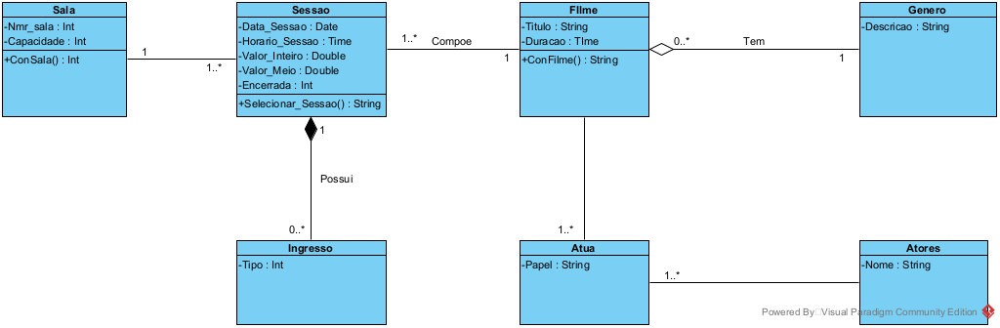
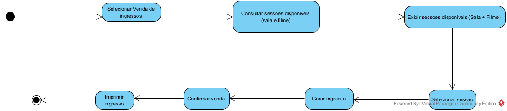
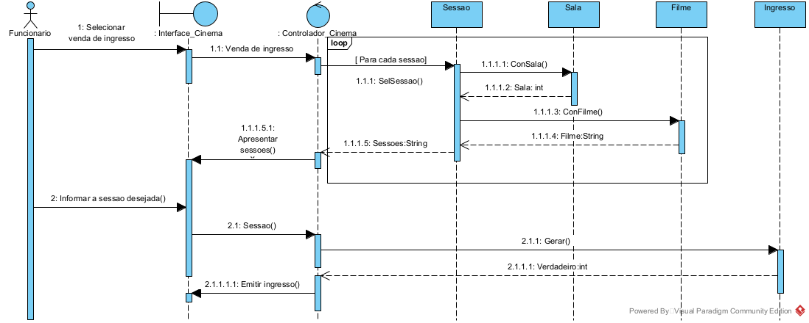

Sistema de Cinema — Diagramas UML

Sobre o projeto

Este repositório reúne os diagramas UML desenvolvidos para representar a estrutura e o comportamento de um sistema de cinema.

Diagrama de Classes

Diagrama de Atividades

Diagrama de Sequência

Arquivos originais

Os arquivos ".vpp" dos diagramas foram disponibilizados na pasta "CINEMA" e podem ser baixados para edição no Visual Paradigm.